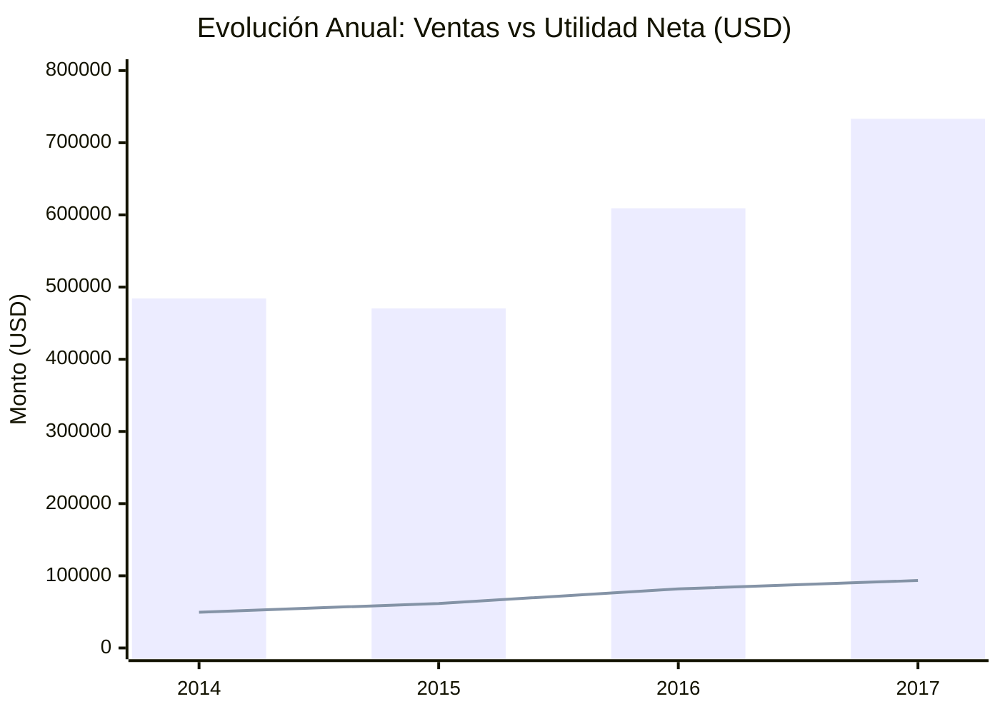
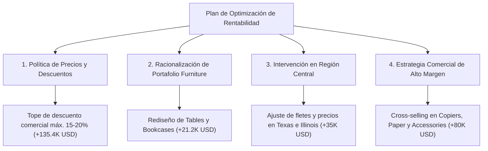

# Informe Ejecutivo & Análisis de Rentabilidad Financiera

**Empresa / Dataset:** Superstore Commercial Operations  
**Período Analizado:** 2014 – 2017 (9,994 transacciones auditadas)  
**Entregable Interactivo:** [Dashboard_Rentabilidad_Superstore.html](file:///c:/Users/mdela/OneDrive/Documentos/ANALISIS%20DE%20RENTABILIDAD/Dashboard_Rentabilidad_Superstore.html)

---

## 1. Resumen Ejecutivo & KPIs Financieros Clave

A partir del análisis cuantitativo riguroso de las operaciones comerciales, los resultados globales consolidados son:

| Indicador Financiero (KPI) | Resultado Global | Comportamiento & Diagnóstico |
| :--- | :--- | :--- |
| **Ingresos Totales (Sales)** | **\$2,297,201 USD** | Crecimiento sostenido de \$484K en 2014 a \$733K en 2017 (+51.4%). |
| **Utilidad Neta (Net Profit)** | **\$286,397 USD** | Crecimiento anual de \$49.5K en 2014 a \$93.4K en 2017 (+88.6%). |
| **Margen Neto (ROS %)** | **12.47%** | Saludable a nivel agregado, pero con severa dispersión interna (desde -8.6% hasta +44.4%). |
| **Descuento Promedio Otorgado** | **15.62%** | Variable crítica que actualmente destruye más de \$135K en rentabilidad. |
| **Volumen / Órdenes** | **9,994 transacciones (5,010 órdenes)** | Ticket promedio de \$458.5 USD por orden. |

---

## 2. Análisis por Regiones

| Región | Ventas (Sales) | Utilidad Neta (Profit) | Margen Neto (%) | Diagnóstico Financiero |
| :--- | :---: | :---: | :---: | :--- |
| **West** | \$725,458 | **\$108,419** | **14.94%** | **Región Líder:** Mejor balance volumen-margen y control de descuentos. |
| **East** | \$678,781 | **\$91,523** | **13.48%** | **Sólida:** Alto volumen en ciudades clave (NY) con margen robusto. |
| **South** | \$391,722 | **\$46,750** | **11.93%** | **Estable:** Menor tamaño de mercado relativo, margen dentro del rango esperado. |
| **Central** | \$501,240 | **\$39,707** | **7.92%** | **Alerta Crítica:** Margen casi la mitad del promedio por descuentos agresivos en Texas e Illinois. |

---

## 3. Análisis por Segmento de Cliente

| Segmento | Ventas (Sales) | % Total Ventas | Utilidad (Profit) | Margen Neto (%) |
| :--- | :---: | :---: | :---: | :---: |
| **Consumer (Consumidor)** | \$1,161,401 | 50.56% | \$134,119 | 11.55% |
| **Corporate (Corporativo)** | \$706,146 | 30.74% | \$91,979 | 13.03% |
| **Home Office (Oficina en Casa)** | \$429,653 | 18.70% | \$60,299 | **14.03%** |

> [!NOTE]
> Aunque el segmento **Consumer** aporta el 50.6% de la facturación, **Home Office** es el segmento más eficiente en términos de margen operativo neto (14.03%), debido a una menor tasa de descuentos y tickets con mayor proporción de tecnología y suministros.

---

## 4. Análisis por Categorías y Subcategorías

### Rendimiento por Macro-Categoría

1. **Technology:** **\$836,154** ventas | **\$145,455** utilidad (**17.39% de margen**). Es el principal motor generador de valor de la compañía.
2. **Office Supplies:** **\$719,047** ventas | **\$122,491** utilidad (**17.03% de margen**). Excelente balance entre alta rotación y alto retorno.
3. **Furniture (Muebles):** **\$741,200** ventas | **\$18,451** utilidad (**2.49% de margen**). Desempeño crítico: absorbe el 32% del capital de ventas pero entrega únicamente el 6.4% de las ganancias netas.

### Matriz de Subcategorías: Generadores vs. Destructores de Valor

| Subcategoría | Categoría | Ventas | Utilidad Neta | Margen (%) | Descuento Prom. | Estado Financiero |
| :--- | :--- | :---: | :---: | :---: | :---: | :--- |
| **Copiers** | Technology | \$149,528 | **+\$55,618** | **37.20%** | 16.2% | Motor Estrella |
| **Phones** | Technology | \$330,007 | **+\$44,516** | 13.49% | 15.5% | Alto Volumen / Rentable |
| **Accessories** | Technology | \$167,380 | **+\$41,937** | **25.05%** | 7.8% | Motor Estrella |
| **Paper** | Office Supplies | \$78,479 | **+\$34,054** | **43.39%** | 7.5% | Máxima Rentabilidad |
| **Binders** | Office Supplies | \$203,413 | **+\$30,222** | 14.86% | 37.2% | Alto Volumen / Riesgo Descuentos |
| *...* | *...* | *...* | *...* | *...* | *...* | *...* |
| **Supplies** | Office Supplies | \$46,674 | **-\$1,189** | -2.55% | 7.7% | Pérdida Margen Menor |
| **Bookcases** | Furniture | \$114,880 | **-\$3,473** | **-3.02%** | 21.1% | Destructor de Valor |
| **Tables** | Furniture | \$206,966 | **-\$17,725** | **-8.56%** | **26.1%** | **Destructor Severo de Valor** |

---

## 5. Causa Raíz Forense: Destrucción de Margen por Descuentos

Al cruzar los tramos de descuento con el beneficio neto, se comprueba una correlación letal:

| Rango de Descuento | Facturación (Sales) | Utilidad Neta (Profit) | Margen Neto (%) | N° Transacciones |
| :--- | :---: | :---: | :---: | :---: |
| **0% (Sin Descuento)** | \$1,087,908 | **+\$320,988** | **+29.50%** | 4,798 |
| **1% – 10%** | \$54,369 | **+\$9,029** | **+16.61%** | 94 |
| **11% – 20%** | \$792,153 | **+\$91,757** | **+11.58%** | 3,709 |
| **21% – 40%** | \$234,138 | **-\$35,818** | **-15.30%** | 460 |
| **> 40% (Hiper-descuentos)** | \$128,632 | **-\$99,559** | **-77.40%** | 933 |

> [!CAUTION]
> **El Punto de Inflexión Financiero:** Cualquier descuento superior al **20%** elimina por completo la rentabilidad bruta del producto. El acumulado de órdenes en el tramo >20% genera **-\$135,377 USD de pérdida pura**.

---

## 6. Oportunidades de Mejora & Plan de Acción Estratégico

1. **Racionalización Inmediata de la Política de Descuentos (Impacto: +\$135,377 USD):**
   - **Acción:** Restringir descuentos por encima del 20% a un proceso de aprobación previo por la Dirección Financiera.
   - **Justificación:** Se eliminan de inmediato \$135K de pérdidas en 1,393 transacciones no rentables.

2. **Reestructuración de Portafolio en Tables y Bookcases (Impacto: +\$21,198 USD):**
   - **Acción:** Detener promociones en `Tables` (margen -8.6%), trasladar el costo real de embalaje y flete al cliente final, o descontinuar modelos con margen negativo crónico.

3. **Plan de Rescate de Margen en Región Central (Impacto: +\$35,000 USD):**
   - **Acción:** La región Central tiene un margen de 7.9% vs el 14.9% de West. Auditar los contratos corporativos en los estados de Texas e Illinois para alinear precios y fletes.

4. **Incentivos a Motores de Rentabilidad (Impacto Proyectado: +\$80,000+ USD en EBITDA):**
   - **Acción:** Alinear las comisiones de la fuerza comercial al margen neto (no solo a volumen de ventas), incentivando subcategorías como `Copiers` (37.2% margen) y `Paper` (43.4% margen).
